# Zoo Management System

A Windows desktop app for running a zoo, built in C# (WinForms) for my OOP-II course. Four kinds of users (admin, doctor, staff and visitor) each get their own screens. They all share one SQL Server database.

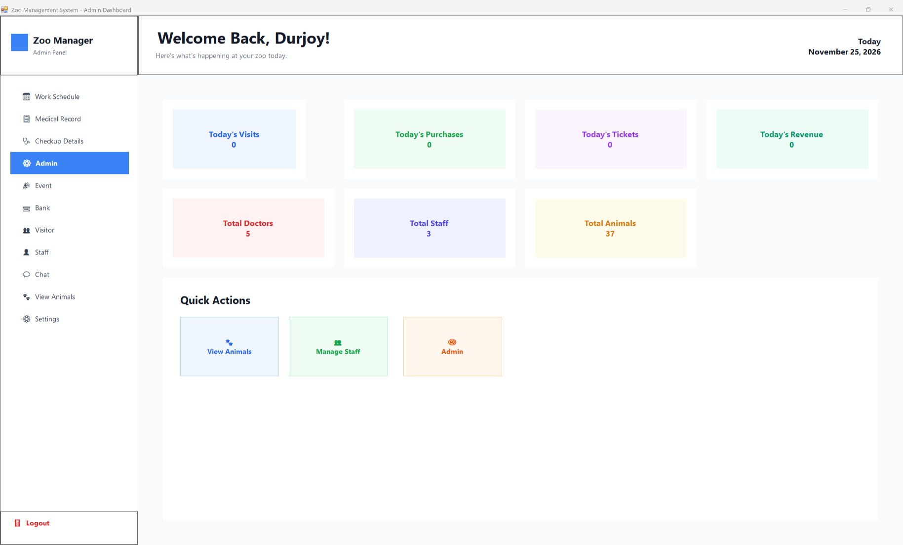

## Key features

- **OTP email verification** on sign-up and password reset (Gmail SMTP)
- **Bank-integrated payments**: pick a bank, enter an account, confirm with an OTP sent to the account holder's email
- **Animal management**: admins add, edit and delete animals with photos and health status; visitors browse them in a searchable showcase
- **Internal chat** between admins, doctors and staff, with unread messages on the doctor dashboard
- **Shop with a cart**: add souvenirs, view the cart total, clear it or remove the last item
- **Hidden admin login**: press **Shift + A** on the login screen
- **Health records**: doctors log checkups (weight, temperature, heart rate) and treatments with medicines and next visit dates
- **Work schedules**: admins assign daily tasks per animal; doctors and staff see today's tasks
- **Staff animal reports**: appearance, temperature, appetite, hydration, eyes, breathing
- **Tickets and memberships**: Gold and Silver plans with adult and child counts, Direct Debit or card
- **Getting here**: a live zoo map with GMap.NET, plus an accessibility video

## What each role can do

| Role | What they can do |
|------|------------------|
| **Admin** | Dashboard with today's visits, purchases, tickets and revenue. Manage staff, doctors, visitors, animals, events and bank accounts. Assign work schedules. Review checkups and medical records. Chat. |
| **Doctor** | Recent checkups and medical records, add new ones, today's tasks, unread messages, chat. |
| **Staff** | Assigned tasks, daily animal status reports, view animals, chat. |
| **Visitor** | Sign up with an email OTP. Buy tickets and memberships. Shop with a cart. See upcoming events. Pay from a bank account with an OTP check. Leave feedback. See the map and the accessibility video. |

## Screenshots

| | |
|---|---|
| 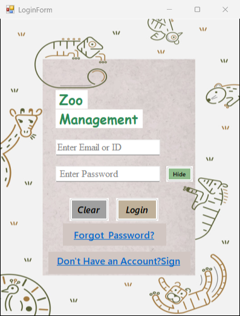   One login for four roles | 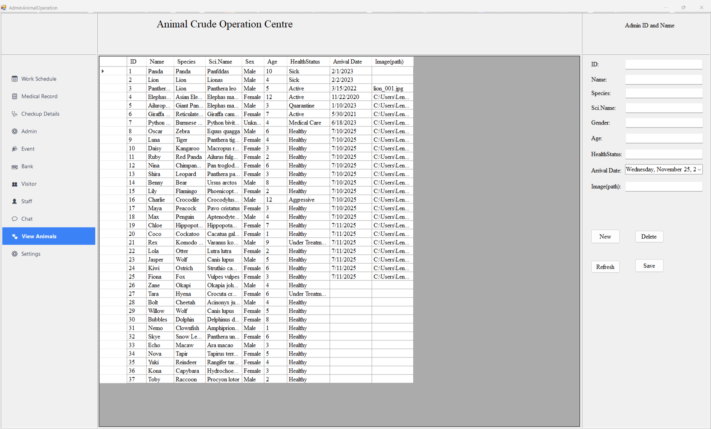   Animal management (admin) |
| 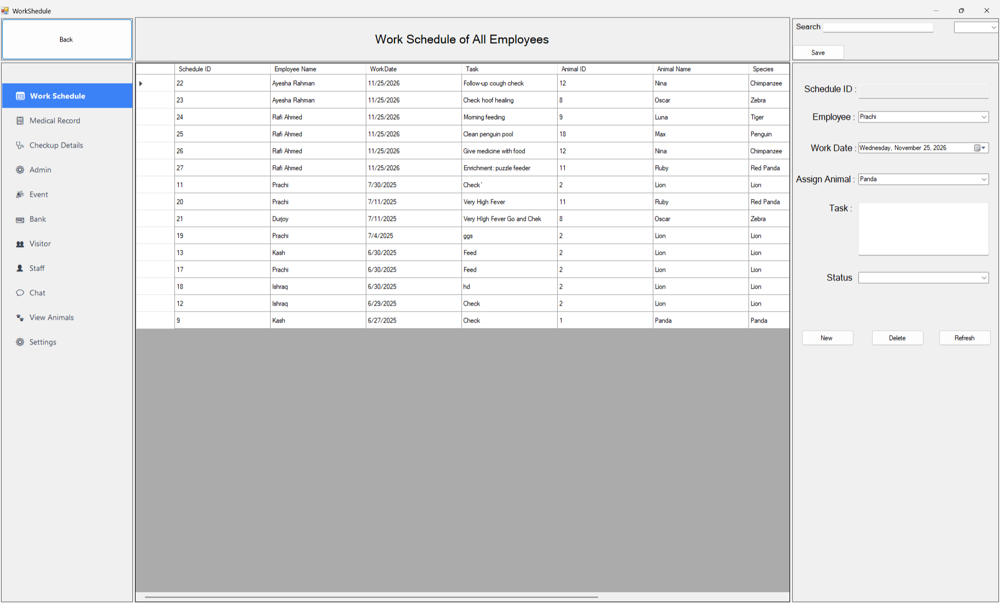   Work schedules | 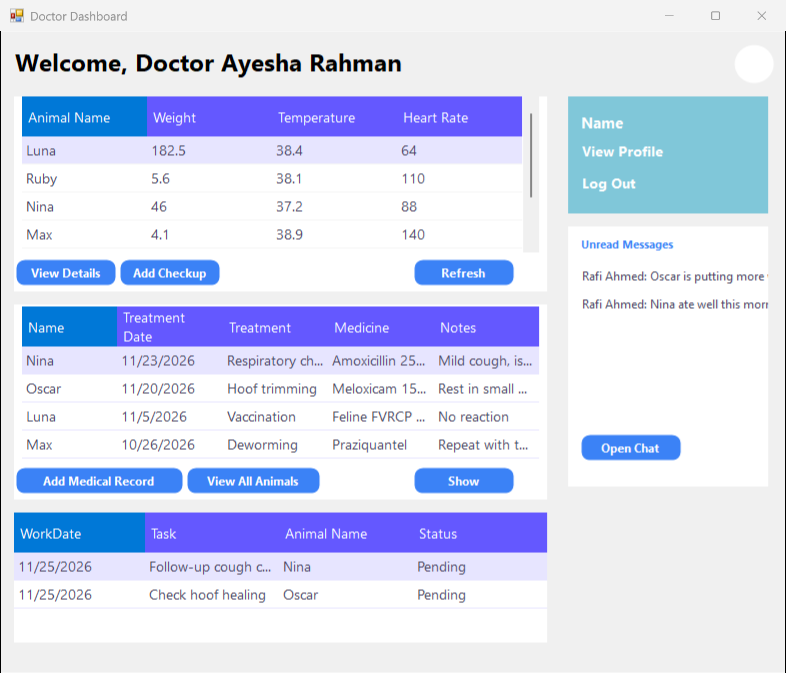   Doctor dashboard |
| 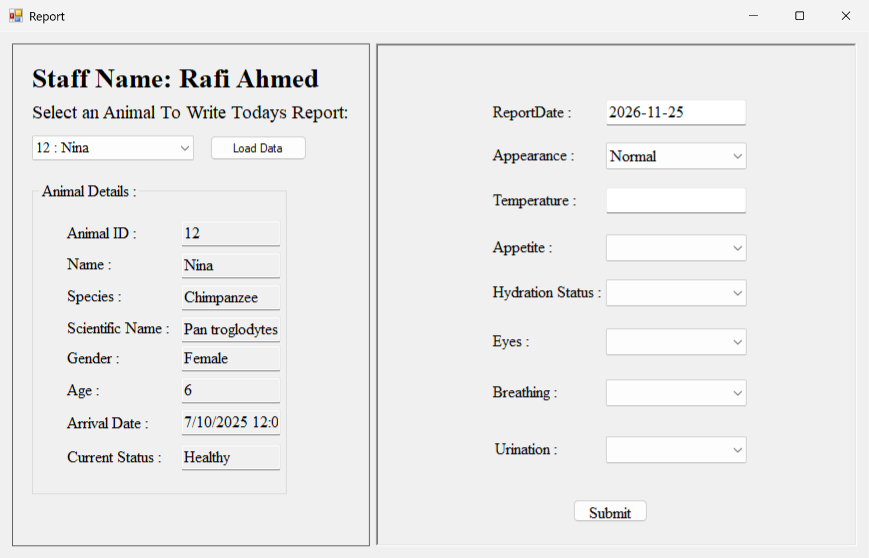   Staff animal report | 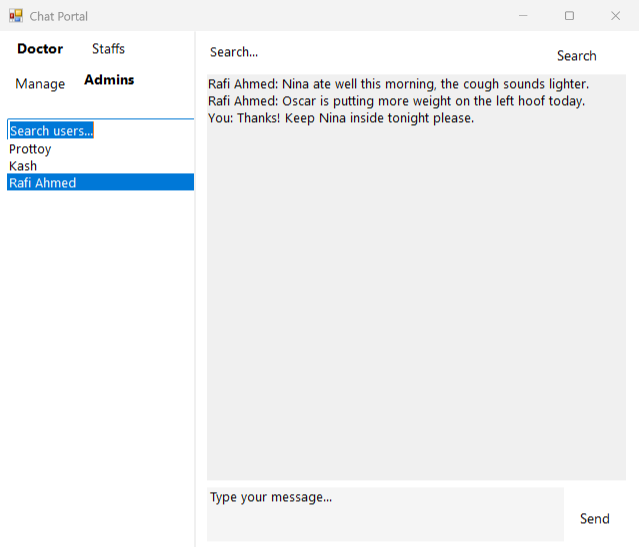   Internal chat |
| 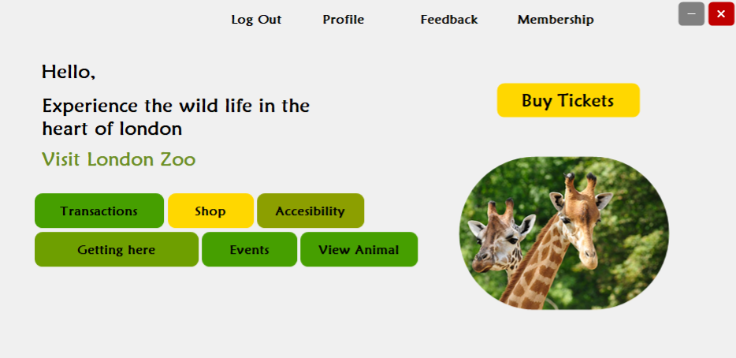   Visitor home | 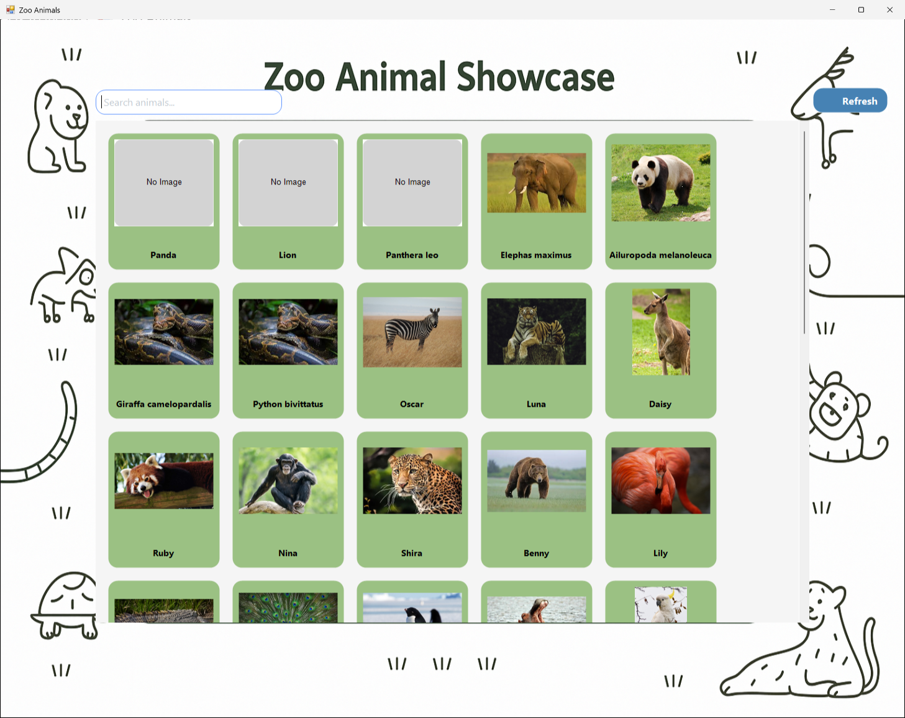   Animal showcase |
| 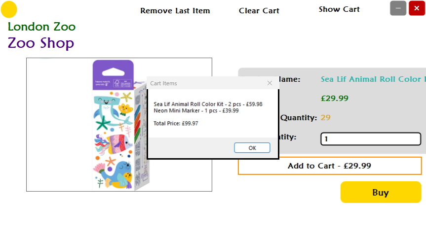   Shop with cart | 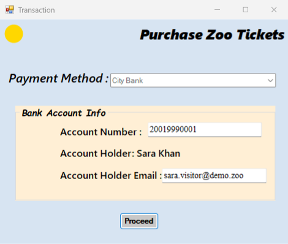   Bank payment |
| 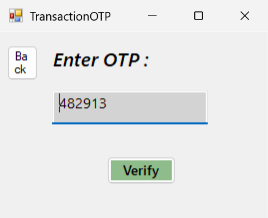   Payment OTP | 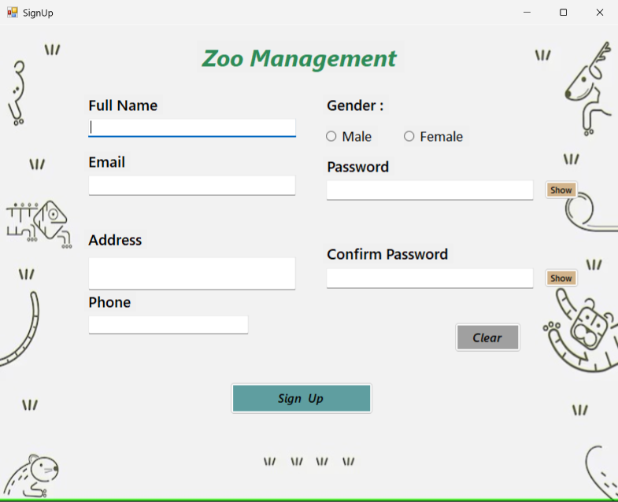   Sign up |
| 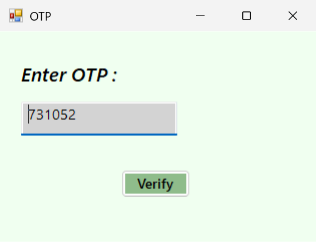   Email OTP verification | 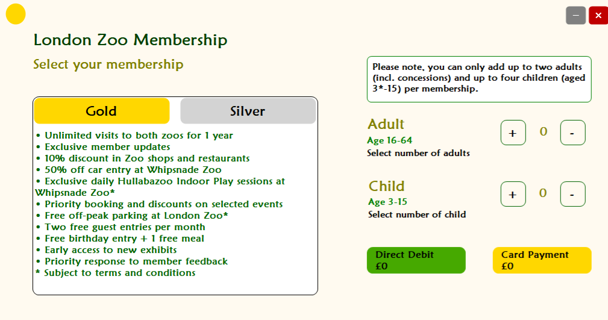   Membership plans |
| 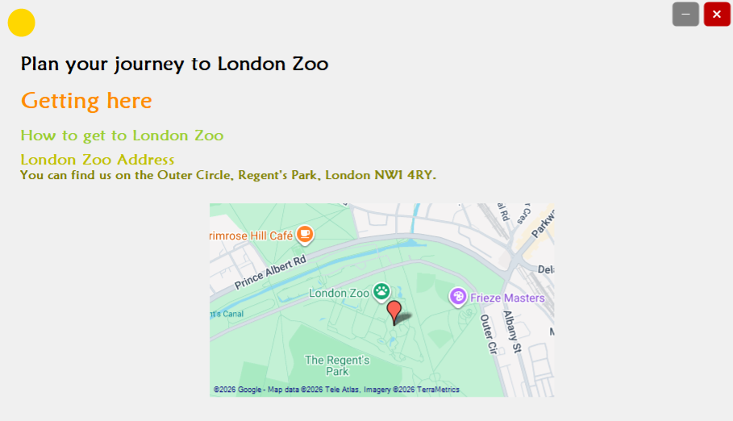   Zoo map | |

## Tech stack

- C# on .NET Framework 4.7.2, Windows Forms
- SQL Server Express through ADO.NET (`System.Data.SqlClient`)
- Guna UI2 for the styled controls
- GMap.NET for the zoo map
- Vlc.DotNet for the accessibility video
- Gmail SMTP (`System.Net.Mail`) for the OTP emails

## Run it locally

You need Windows, Visual Studio and SQL Server Express (instance name `SQLEXPRESS`).

1. Create the database: run `Sql/Sql.sql` in SQL Server Management Studio. It creates a database called `Project` with sample data. If your SQL Server is not version 16, change the data-file paths at the top of the script first.
2. Point the app at your server. The connection string is in `Zoo Management System/DataAccess.cs` (lines 18 and 44). Replace `LAPTOP-VA6SNT9S` with your computer name.
3. For OTP emails, copy `Zoo Management System/secrets.example.config` to `secrets.config` in the same folder, then fill in a Gmail address and an [app password](https://myaccount.google.com/apppasswords). `secrets.config` is git-ignored.
4. Open `ZooManagementSystem.sln`, restore NuGet packages and run.

To log in as an admin, press **Shift + A** while the Login button has focus.

Optional: `Sql/demo-seed.sql` adds a demo doctor, staff member and visitor with checkups, tasks, chats, a cart, a bank account and events. `Sql/demo-cleanup.sql` removes them again.

## Known limitations

This is a student project, not production software:

- The connection string is fixed in the code instead of a config file.
- Passwords are stored as plain text.
- Several queries are built by joining strings, so they are open to SQL injection.
- The map needs an internet connection, and the video needs VLC installed.
